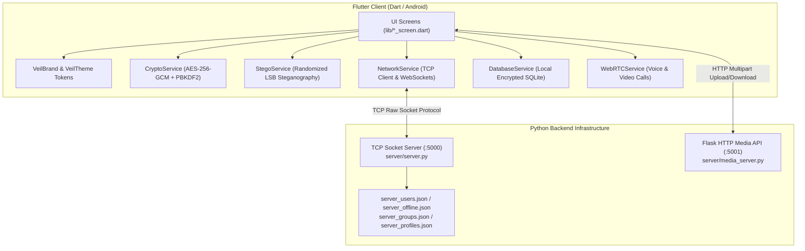

# VeilChat AI Engineering Operating System & Agent Guidelines

Welcome to **VeilChat**. This file defines the operating principles, architectural boundaries, security contracts, coding discipline, and tool orchestration for any AI agent working within this repository.

---

## 1. Project Overview & Architecture

VeilChat is a privacy-first Android & cross-platform messaging application featuring authenticated end-to-end payload encryption and randomized spatial LSB steganography.



### Stack Components
- **Frontend**: Flutter 3.41+ / Dart 3.11+, Android SDK target.
- **Backend**:
  - Raw TCP socket server running on port `5000` (`server/server.py`) handling real-time messaging, online presence, group chats, and WebRTC signaling.
  - Flask HTTP media API running on port `5001` (`server/media_server.py`) for encrypted file and steganographic image transfers.
- **Data Persistence**:
  - Local Client: SQLite (`sqflite`), message contents stored as AES-256-GCM encrypted ciphertext. Note: full-disk SQLCipher and `flutter_secure_storage` credential persistence are not currently active in source code.
  - Backend: JSON-backed structured stores (`server_users.json`, `server_offline.json`, `server_groups.json`, `server_profiles.json`) with bcrypt password hashing.
- **Media & Steganography**: `image` package and `gal` library for camera roll and scoped storage gallery access.

---

## 2. Frontend and Backend Boundaries

1. **Client Isolation**: The Flutter app must never assume direct access to server storage files. All communication is strictly mediated via the TCP socket (`:5000`) or the HTTP media API (`:5001`).
2. **Zero-Trust Server Relay**: The server is a message broker and store-and-forward relay. The server cannot and must not inspect private message payloads, encryption keys, or steganographic image payloads.
3. **No Cross-Contamination**: Backend code (`server/`) is written in Python. Frontend code (`lib/`, `test/`) is written in Dart. Never mix dependencies or import patterns across this boundary.

---

## 3. Cryptographic and Security Requirements

This is a privacy-oriented messaging application. AI agents working on VeilChat must strictly follow these security guarantees:

1. **AES-256-GCM Payload Integrity**:
   - Every private message is encrypted using `AesGcm.with256bits(nonceLength: 16)`.
   - The encrypted wire payload format is strictly `[SALT(16 bytes)][NONCE(16 bytes)][MAC(16 bytes)][CIPHERTEXT]`. Header minimum length is 48 bytes.
   - Decryption failures (such as `SecretBoxAuthenticationError`) must fail closed and return `null`—never ignore authentication tags.
2. **PBKDF2 Key Derivation**:
   - `Pbkdf2(macAlgorithm: Hmac.sha256(), iterations: 10000, bits: 256)`.
   - Salt must be cryptographically random per message using `Random.secure()`. Nonces must never be reused.
   - Do not weaken key derivation iterations or change algorithms without comprehensive migration tests.
3. **Randomized LSB Steganography**:
   - Pixels are permuted pseudorandomly using `_shuffledIndices(w, h, password)` seeded by the SHA-256 digest of the shared secret.
   - The payload embeds into the Red channel LSB (`(px.r & 0xFE) | bit`).
   - The first 32 bits store the exact payload length in bytes. Never alter this binary layout.
4. **No Plaintext Logging**:
   - Never log plaintext messages, decryption passwords, session keys, or user credentials into `print()`, `debugPrint()`, or crash logs.
5. **No Invented Security Guarantees**:
   - Do not claim the system is "mathematically zero-knowledge" without verifying what metadata (IP, connection time, username) reaches the server. Be rigorously accurate.

---

## 4. Coding Discipline (Ponytail Senior Mode)

VeilChat enforces the **Ponytail** engineering discipline (`DietrichGebert/ponytail`):
*The best code is the code never written. Solve the whole problem with the least new code.*

1. **Read Before Writing**: Inspect the task and all code it touches (`callers, tests, models, services`). List what could break.
2. **Minimal Working Change**:
   - *YAGNI*: Skip unnecessary abstractions, unused configuration parameters, and speculative features.
   - *Codebase Reuse*: Look for existing helpers in `lib/services/` (`CryptoService`, `NetworkService`, `DatabaseService`, `StegoService`) before creating new ones.
   - *Platform / Stdlib First*: Use Dart/Flutter built-ins where possible.
   - *No Bloat*: Never pull in a new pub or pip dependency when existing libraries can fulfill the requirement.
3. **Preserve Working Functionality**: Do not break existing tests, themes, or socket state machines.
4. **Verification**: Any new logic must be accompanied by an automated test or executable self-check. Report verification results honestly without claiming success for unexecuted checks.

---

## 5. API Contracts & Wire Protocol

### TCP Socket Protocol (`:5000`)
Packets are JSON strings followed by a newline `\n`.
- **Register**: `{"type": "REGISTER", "username": "<user>", "password": "<pass>"}`
- **Login**: `{"type": "LOGIN", "username": "<user>", "password": "<pass>"}` (Note: type is `LOGIN`, not `AUTH`)
- **Direct Message**: `{"type": "TEXT", "to_user": "<target>", "content": "<encrypted_payload>", "sender": "<sender>"}`
- **Offline Messages**: Automatically queued when target is offline and flushed upon next authentication.
- **WebRTC Signaling**: `{"type": "OFFER" | "ANSWER" | "ICE" | "END", "to_user": "<target>", "payload": <data>}`

### HTTP Media API (`:5001`)
- `GET /health` -> `{"status": "ok"}`
- `POST /upload` -> Multipart form-data upload returning media ID or URL.
- `GET /media/<filename>` -> Fetches uploaded media stream.

---

## 6. Database Constraints

- SQLite schema managed in `lib/services/database_service.dart`.
- Tables: `messages`, `contacts`, `call_logs`, `file_cache`, `groups`, `group_messages`, `user_profile`. (Note: conversations are dynamic queries on `messages`, not a standalone table).
- Columns store encrypted ciphertext for message contents.
- Indexing must support fast query by conversation ID and timestamp for pagination.

---

## 7. Design System Guidelines (UI/UX Pro Max & Vercel Guidelines)

VeilChat is a native Flutter application with a futuristic, cyber-privacy aesthetic.
- **Tokens**: Strictly use `VeilBrand` (`lib/branding/veil_brand.dart`) and `VeilTheme` (`lib/veil_theme.dart`).
  - Dark base: `veilVoid` (`#05070F`), `veilInk` (`#0B1020`), `veilSlate` (`#161B2E`).
  - Accents: `veilIndigo` (`#6366F1`), `veilTeal` (`#2DD4BF`), `veilCyan` (`#22D3EE`).
  - Text: Contrast ratio must meet WCAG AA standards (4.5:1 for normal text, 3:1 for large text).
- **Responsive Layout**: Support both mobile and tablet portrait/landscape orientations using `LayoutBuilder` and `MediaQuery`.
- **State Feedback**: Every interactive screen must handle:
  1. *Loading*: Smooth shimmer or cyber spinner.
  2. *Empty*: Informative cyber illustration/text explaining the next step.
  3. *Error*: Clear, non-technical recovery actions with retry capability.
- **No Web-Only Frameworks**: Never inject HTML/React/Tailwind code into Flutter widgets.

---

## 8. Skill & Tool Activation Matrix

Agents must activate tools selectively based on task scope to optimize token usage and reasoning accuracy:

| Task Domain | Required Skills & Tools | Trigger / Purpose |
|---|---|---|
| **General Coding & Refactoring** | `ponytail` | Enforces minimal, complete, safe diffs; YAGNI evaluation. |
| **Flutter Widget & App Architecture** | `flutter-apply-architecture-best-practices`<br>`flutter-build-responsive-layout`<br>`flutter-fix-layout-issues` | Designing widgets, responsive views, fixing RenderFlex issues. |
| **Dart Logic & Concurrency** | `dart-use-pattern-matching`<br>`dart-use-primary-constructors`<br>`dart-run-static-analysis` | Idiomatic Dart 3 syntax, isolates, stream management. |
| **UI/UX Design & Theming** | `ui-ux-pro-max`<br>`design-system` | Mobile UI/UX consistency, spacing scales, micro-interactions. |
| **Frontend Quality Review** | `web-design-guidelines` | Accessibility (a11y), touch targets, color contrast, focus states. |
| **Python Backend Maintenance** | `ponytail` + Isolated `bandit` (`.ai-toolkit\venv`) | Server code changes, socket concurrency, API route additions. |
| **Security & Privacy Audits** | `bandit` + `semgrep` (when available) | Cryptographic verification, secret scanning, SQL injection checks. |
| **Documentation & API Lookup** | `context7` + `google-developer-knowledge` | Official real-time package API docs (Flutter, cryptography, etc.). |
| **Release & QA Verification** | `flutter test`<br>`dart analyze`<br>`python server/test_backend.py` | Full pre-release regression verification. |

---

## 9. Testing & Quality Standards

Before declaring any coding task complete:
1. **Dart Static Analysis**:
   ```bash
   flutter analyze
   ```
2. **Dart Formatting**:
   ```bash
   dart format --output=none --set-exit-if-changed lib test tool
   ```
3. **Flutter Unit & Widget Tests**:
   ```bash
   flutter test
   ```
4. **Python Backend Unit Tests**:
   ```bash
   python server/test_backend.py
   ```
5. **Python Backend Security Scan**:
   ```bash
   .ai-toolkit\venv\Scripts\bandit -r server
   ```

---

## 10. Strict Project Isolation Policy

- **All tools, virtual environments, skills, rules, and configurations belong exclusively to VeilChat.**
- Never run global package installations (`npm install -g`, `pip install` into global environment).
- Never modify user-global configurations (`~/.gemini`, `~/.config`).
- All tool state is confined to:
  - `.agents/`
  - `.ai-toolkit/`
  - `AGENTS.md`
  - `docs/`
