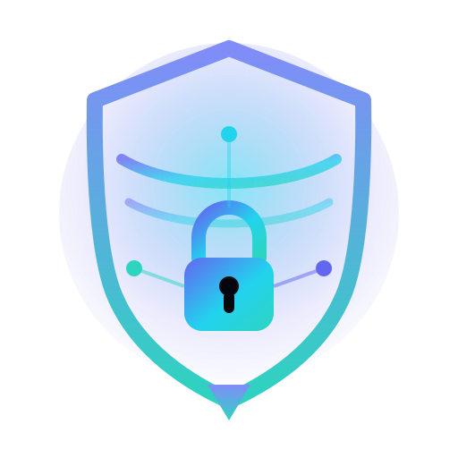
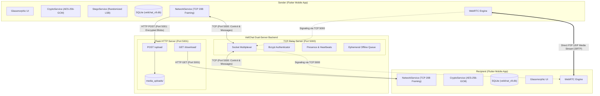
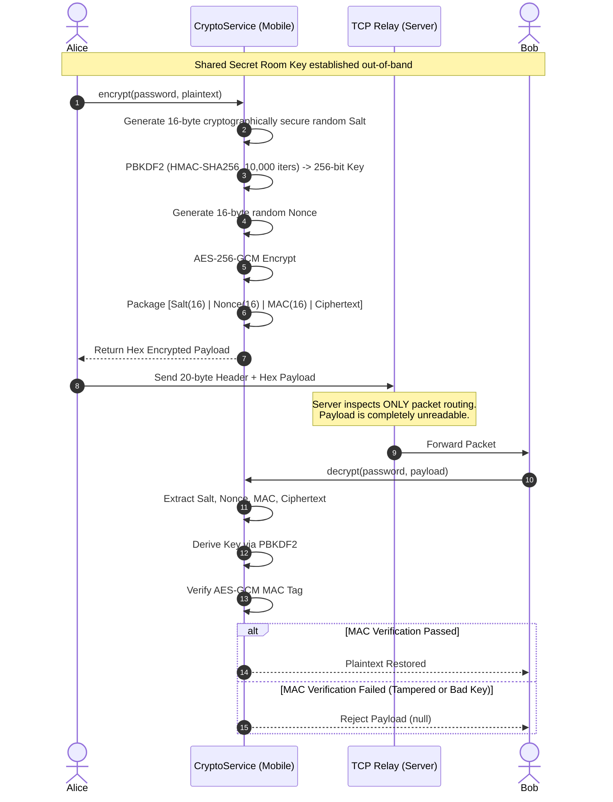
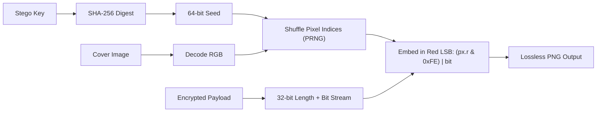

# VeilChat — Confidential Steganography Chat

<p align="center">
  
</p>

<p align="center">
  <strong>A privacy-focused Android messaging application combining AES-256-GCM authenticated encryption, randomized LSB image steganography, and WebRTC peer-to-peer communication.</strong>
</p>

<p align="center">
  
  
  
  
  
</p>

---

## 1. Product Overview

In contemporary digital messaging, traditional encryption alone signals to network observers that sensitive data is being transmitted. **VeilChat** bridges this critical gap by fusing cryptography with **image-based steganography**, concealing not only the message content but also the very existence of confidential communication.

Built using **Flutter** for the mobile client and a **dual-service Python backend**, VeilChat guarantees strict local data sovereignty: messages and private keys exist only on the user's physical device, while the central relay infrastructure acts as a blind postman.

---

## 2. Key Features

* **Authenticated Encryption (AES-256-GCM)**: All messages and file payloads are encrypted client-side using 256-bit AES in Galois/Counter Mode with 128-bit MAC verification.
* **PBKDF2 Key Derivation**: Symmetric keys are derived using PBKDF2 with HMAC-SHA256 and 10,000 iterations from a shared Room Key, balancing brute-force resistance with smooth mobile performance.
* **Randomized LSB Steganography**: Embeds secret text or encrypted payloads into carrier images by non-linearly shuffling Red-channel pixel indices using a SHA-256-seeded PRNG, defeating linear steganalysis scripts.
* **Decoupled Dual-Server Backend**:
  * **TCP Relay Server (Port 5000)**: Ultra-fast socket relay with a custom 20-byte fixed header framing protocol for real-time messaging, presence, and WebRTC signaling.
  * **Flask Media Server (Port 5001)**: Out-of-band transport for heavy pre-encrypted image, voice, and document transfers up to 50MB.
* **WebRTC Voice & Video Calling**: True peer-to-peer VoIP and video connections over direct UDP streams, utilizing Google STUN servers and openrelay TURN relays for symmetric NAT traversal.
* **Local Sovereign SQLite Database**: SQLite database (`veilchat_v9.db`) with automatic schema introspection and zero-downtime column migrations.
* **Glassmorphic Cyberpunk UI**: Translucent frosted-glass aesthetics, custom canvas vector painters, and unified haptic feedback.
* **Ephemeral Offline Queuing**: Offline messages are buffered on the relay server in memory and purged immediately upon delivery.
* **Group Messaging with Admin Controls**: Create encrypted rooms, invite members, promote/demote admins, and manage custom room wallpapers.

---

## 3. High-Level Architecture

VeilChat separates lightweight real-time control traffic from heavy binary transfers to ensure smooth mobile performance and zero server-side bottlenecks.



### Why Two Separate Backend Services?
1. **Thread Concurrency**: Instant messaging demands sub-millisecond socket responsiveness. Routing a 20MB encrypted image over the persistent TCP socket would block the event loop and introduce noticeable typing/signaling latency for other users.
2. **Failure Isolation**: An HTTP upload timeout or disk I/O burst on the media server has zero impact on live real-time chats or active WebRTC calls.
3. **Bandwidth Optimization**: The Flask media server can be scaled, cached, or placed behind a reverse proxy (e.g. Nginx) independently of the stateful TCP connection pool.

---

## 4. Security & Cryptographic Workflow



### Payload Structure
```
+----------------+----------------+----------------+--------------------------+
|  Salt (16 B)   |  Nonce (16 B)  |   MAC (16 B)   |   Ciphertext (Variable)  |
+----------------+----------------+----------------+--------------------------+
```
* **Total Prefix**: 48 bytes.
* **Integrity Enforcement**: Any bit flip in transit invalidates the GCM authentication tag, causing immediate rejection.

---

## 5. Steganography Workflow

VeilChat embeds secret data into standard images using **Randomized Least Significant Bit (LSB)** steganography:



1. The user selects a carrier image and provides a secret passphrase.
2. The SHA-256 digest of the passphrase generates a 64-bit seed.
3. The image's pixel indices are pseudo-randomly shuffled using this seed.
4. The 32-bit payload length prefix and data bits are embedded into the Red channel's least significant bit.
5. The output is saved strictly as a lossless PNG to preserve pixel values.

---

## 6. Installation & Quick Start

### 6.1 Prerequisites
* **Python**: 3.10+
* **Flutter**: 3.19.0+ (Tested with Flutter 3.41.2 / Dart 3.11.0)
* **Android SDK**: API Level 34+
* **JDK**: OpenJDK 17 or 21

---

### 6.2 Backend Startup
In a terminal, navigate to the `server/` directory:

```bash
cd server
python -m venv venv

# Windows:
.\venv\Scripts\activate
# Linux/macOS:
source venv/bin/activate

pip install -r requirements.txt
```

Launch both servers:
* **Windows**: Run `server\run_all.bat`
* **Manual**:
  ```bash
  # Terminal 1: Real-time TCP Relay
  python server/server.py

  # Terminal 2: HTTP Media Server
  python server/media_server.py
  ```

---

### 6.3 Mobile App Startup
From the project root:

```bash
# Fetch Flutter packages
flutter pub get

# Run on connected Android device or emulator
flutter run
```

#### Server IP Configuration:
1. Tap the **Server Config** icon on the Login Screen.
2. Enter your host IP:
   * **Android Emulator**: `10.0.2.2`
   * **Physical Device**: Your computer's local Wi-Fi IP (e.g., `192.168.1.50`).
3. Set TCP port to `5000` (HTTP media server on port `5001` is resolved automatically).

---

### 6.4 Build Release APK
```bash
flutter build apk --release
```
The compiled package will be located at:
`build/app/outputs/flutter-apk/app-release.apk`

---

## 7. Automated Testing

### Backend Unit Tests
```bash
python -m unittest scratch/test_backend.py
```

### Flutter & Cryptography Tests
```bash
flutter test test/crypto_stego_test.dart
```

### Static Analysis
```bash
flutter analyze
```

---

## 8. Documentation Index

Detailed engineering documentation is available in the [`docs/`](docs/) directory:

* [System Architecture](docs/architecture.md) — Comprehensive mobile-to-backend system design.
* [Installation Guide](docs/installation.md) — Step-by-step development and deployment setup.
* [Configuration Reference](docs/configuration.md) — Ports, endpoints, and environment settings.
* [Security Model](docs/security-model.md) — AES-256-GCM, PBKDF2 parameters, and steganography specifications.
* [Threat Model](docs/threat-model.md) — Protected vectors, trust boundaries, and known limitations.
* [Networking & Wire Protocol](docs/networking.md) — 20-byte TCP header specification and REST endpoints.
* [Database Schema](docs/database.md) — SQLite tables, indexing, and migration logic.
* [Troubleshooting](docs/troubleshooting.md) — Solutions for common connectivity, media, and build issues.

---

## 9. Security Notice & Limitations

* **Plausible Deniability**: LSB steganography is visually imperceptible. However, high embedding ratios alter color frequency statistics. Keep payload sizes below 5% of the carrier image's pixel capacity to avoid statistical detection.
* **Shared Room Key**: VeilChat employs pre-shared symmetric keys. If a counterparty exposes their shared key, previous messages encrypted with that key become readable. Future versions will incorporate the Double Ratchet Algorithm for forward secrecy.
* **Responsible Disclosure**: Please review our [Security Policy](SECURITY.md) before reporting security findings.

---

## 10. Contributing

We welcome community contributions! Please review [CONTRIBUTING.md](CONTRIBUTING.md) and [CODE_OF_CONDUCT.md](CODE_OF_CONDUCT.md) before submitting a pull request.

---

## 11. Authors & Acknowledgments

### Core Contributors
* **Asma Zarbab**
* **Bushra Allah Ditta**
* **Sehar Ashfaq**
* **Tooba Fatima**
* **Farhan Ashraf**
* **Haiz**

### Academic Supervision
* **Ms. Huma Zahid**, Lecturer, Department of Computer Science, Govt Islamia Graduate College (W) Cooper Road, Lahore (affiliated with Lahore College for Women University).

---

## 12. License

This project is licensed under the **MIT License** — see the [LICENSE](LICENSE) file for details.
