# VeilChat System Architecture

## 1. Overview

VeilChat is a privacy-first, zero-knowledge mobile messaging platform designed for confidential communications. It integrates three distinct defense layers:

1. **Cryptographic Layer**: End-to-end authenticated encryption via AES-256-GCM with PBKDF2 key derivation.
2. **Steganographic Layer**: Custom randomized Least Significant Bit (LSB) carrier-image encoding to ensure plausible deniability.
3. **Decentralized Transport Layer**: Peer-to-peer WebRTC audio/video calling coupled with a decoupled dual-server backend for real-time control and out-of-band encrypted media transmission.

```mermaid
flowchart TB
    subgraph ClientA["Client Alice (Flutter/Dart)"]
        UI_A["Glassmorphic UI / Presentation"]
        Crypto_A["CryptoService (AES-256-GCM / PBKDF2)"]
        Stego_A["StegoService (Randomized LSB)"]
        DB_A[("SQLite Database (veilchat_v9.db)")]
        Net_A["NetworkService (TCP Framing)"]
        WebRTC_A["WebRTCService (VoIP / Video)"]
    end

    subgraph Backend["VeilChat Backend Infrastructure"]
        subgraph TCPServer["Real-Time Relay Server (Port 5000)"]
            SockRelay["Socket Multiplexer & Protocol Parser"]
            AuthMod["Authentication & Bcrypt Validator"]
            Presence["User Presence & Heartbeat (Ping/Pong)"]
            OffQueue["Offline Message Store (TTL Queues)"]
            SigRelay["WebRTC SDP & ICE Candidate Relay"]
        end

        subgraph MediaServer["HTTP Media Server (Port 5001)"]
            FlaskAPI["Flask REST Endpoints (/upload, /download)"]
            MediaStore[("Encrypted Media Storage (/media_uploads)")]
        end
    end

    subgraph ClientB["Client Bob (Flutter/Dart)"]
        Net_B["NetworkService (TCP Framing)"]
        WebRTC_B["WebRTCService (VoIP / Video)"]
        Crypto_B["CryptoService (AES-256-GCM / PBKDF2)"]
        DB_B[("SQLite Database (veilchat_v9.db)")]
        UI_B["Glassmorphic UI / Presentation"]
    end

    %% Real-time signaling & messaging
    Net_A <-->|"TCP (20B Header + JSON)"| SockRelay
    SockRelay <-->|"TCP (20B Header + JSON)"| Net_B

    %% Media upload and download
    Net_A -->|"HTTP POST /upload (Encrypted Blobs)"| FlaskAPI
    FlaskAPI --> MediaStore
    FlaskAPI -->|"HTTP GET /download"| Net_B

    %% Direct Peer-to-Peer WebRTC Media
    WebRTC_A <===>|"Direct P2P UDP Media Stream (SRTP)"| WebRTC_B

    %% Signaling path
    WebRTC_A -.->|"SDP Offer / ICE via TCP"| SigRelay
    SigRelay -.->|"SDP Offer / ICE via TCP"| WebRTC_B
```

---

## 2. Frontend Architecture (Flutter / Dart)

The frontend is implemented in Flutter 3 using Dart, strictly targeting Android (with clean cross-platform Dart code).

### 2.1 Service Layer Architecture
The business logic is partitioned into dedicated, autonomous services:

* **`CryptoService` (`lib/services/crypto_service.dart`)**:
  Handles PBKDF2 key derivation, 256-bit AES-GCM encryption/decryption, and hex conversion. Decryption operations run within dedicated background isolates (`compute`) to eliminate frame drops on high-throughput chats.
* **`StegoService` (`lib/services/stego_service.dart`)**:
  Executes pixel-level randomized LSB manipulation over RGB/RGBA raster images. Operates in conjunction with `Gal` for scoped media storage access on Android 10+ (API 29+).
* **`NetworkService` (`lib/services/network_service.dart`)**:
  Manages persistent raw TCP socket lifecycles, reconnect backoff timers, 20-byte fixed packet framing, and exposes reactive broadcast streams (`messageStream`, `userListStream`, `callStream`, `fileTransferStream`).
* **`DatabaseService` (`lib/services/database_service.dart`)**:
  Manages the local SQLite database (`veilchat_v9.db`). Introspects tables at startup via `PRAGMA table_info` to perform dynamic, safe zero-downtime schema migrations.
* **`WebRTCService` (`lib/services/webrtc_service.dart`)**:
  Maintains WebRTC peer connection state machines, STUN/TURN ICE configurations, and local/remote media tracks for both audio-only and video calling.
* **`GroupService` (`lib/services/group_service.dart`)**:
  Coordinates group creation, administrative promotions/demotions, membership states, and optimistic UI updates.
* **`MediaService` (`lib/services/media_service.dart`)**:
  Performs multipart HTTP uploads and stream-piped chunk downloads to the Flask media cluster.

---

## 3. Dual-Server Backend Architecture (Python)

VeilChat separates control traffic from heavy binary transfers through two specialized microservices:

### 3.1 TCP Real-Time Relay Server (`server/server.py` — Port 5000)
* **Purpose**: Ultra-low-latency message routing, user authentication, presence management, and WebRTC signaling.
* **Concurrency**: Multi-threaded socket server using `threading.Lock` synchronization.
* **Protocol Framing**: Strict 20-byte fixed header:
  * Bytes 0–9: Message Type (ASCII, right-padded with whitespace).
  * Bytes 10–19: Payload Length in bytes (ASCII, right-padded with whitespace).
  * Trailing Bytes: JSON-encoded payload.
* **Persistence & State**:
  * `server_users.json`: Registered credentials with 12-round `bcrypt` password hashes.
  * `server_offline.json`: Ephemeral queues storing pending encrypted messages for offline recipients (capped at 200 messages per user).
  * `server_groups.json`: Group membership rosters and ownership records.
  * `server_profiles.json`: Timestamped user presence and `lastSeen` telemetry.

### 3.2 Flask HTTP Media Server (`server/media_server.py` — Port 5001)
* **Purpose**: Out-of-band transport for heavy encrypted assets (images, audio voice notes, documents).
* **Storage**: Local directory `media_uploads/` storing timestamped, UUID-tagged opaque binary files (`<timestamp>_<uuid8>.<ext>`).
* **Protection**:
  * Safe filename resolution via `os.path.basename()` to eliminate directory traversal attacks.
  * Maximum payload enforcement (`MAX_CONTENT_LENGTH = 50 MB`).
  * CORS headers enabled for flexible multi-network deployments.

---

## 4. WebRTC Calling Architecture

VeilChat establishes direct peer-to-peer audio and video communication:

1. **Signaling Handshake**:
   * Caller captures local microphone/camera media stream.
   * Caller generates an SDP Offer, packages it into a `CALL_SIGNAL` packet, and transmits it via the TCP relay.
   * The TCP relay forwards the signal to the Callee.
   * Callee accepts the call, initializes its media devices, generates an SDP Answer, and transmits it back.
2. **Interactive Connectivity Establishment (ICE)**:
   * Both clients query public Google STUN servers (`stun.l.google.com:19302`) to gather ICE candidates.
   * In symmetric NAT or restricted corporate firewall scenarios, candidate exchange falls back to configured TURN relays (`openrelay.metered.ca`).
3. **Media Transport**:
   * Direct SRTP (Secure Real-time Transport Protocol) peer-to-peer data flow over UDP. The media stream does not transit through the VeilChat Python backend.
