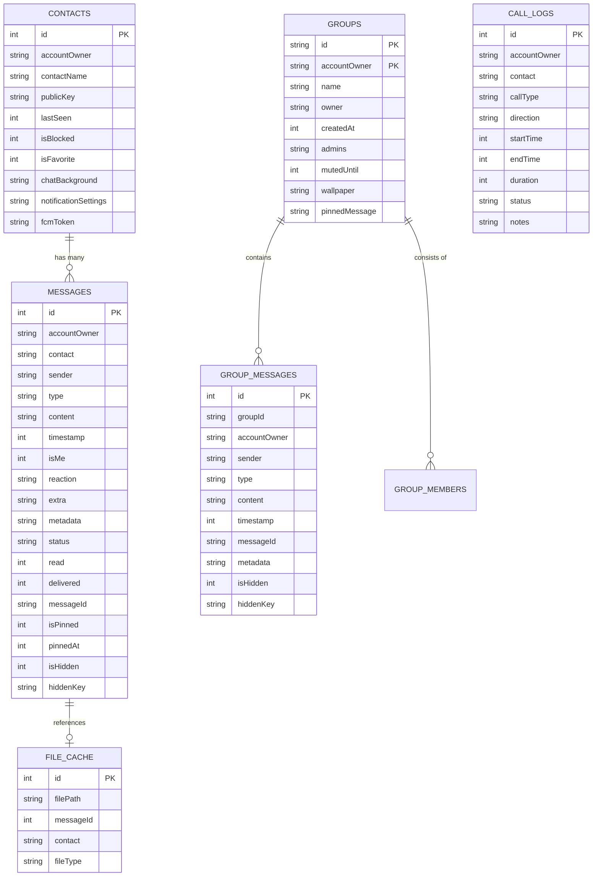

# VeilChat Database Architecture (SQLite)

VeilChat enforces local data sovereignty by storing all chat history, contact records, group memberships, and settings exclusively on the client's physical device in an SQLite database (`veilchat_v9.db`).

---

## 1. Schema Design (Database Version 9)



---

## 2. Table Specifications

### 2.1 `messages` (1:1 Direct Chat)
* **`id`**: Auto-incrementing primary key.
* **`accountOwner`**: The local logged-in user handle (enables multi-user separation on a shared device).
* **`contact`**: The counterparty username.
* **`sender`**: Message author username.
* **`type`**: `TEXT`, `IMAGE`, `AUDIO`, `FILE`, `CALL`.
* **`content`**: The message content. For text, this stores the hex-encoded ciphertext. For media, this stores the filename or local absolute path.
* **`timestamp`**: Epoch millisecond creation time.
* **`isMe`**: `1` if sent by local user, `0` if received.
* **`status`**: Message delivery state (`pending`, `sent`, `delivered`, `read`, `failed`).
* **`isHidden` / `hiddenKey`**: Steganography flags. If `isHidden = 1`, the message is concealed until unlocked with the matching `hiddenKey`.
* **`isPinned` / `pinnedAt`**: Pinning telemetry for important messages.

### 2.2 `groups` & `group_messages`
* **Composite Primary Key**: `groups` uses `PRIMARY KEY (id, accountOwner)` to guarantee that different accounts logging in on the same phone maintain isolated group lists without clobbering records.
* **`admins`**: JSON array string of usernames holding administrator privileges.
* **`mutedUntil`**: Epoch millisecond timestamp until which notifications are suppressed.

---

## 3. Indexing Strategy

To maintain smooth 60fps scrolling over conversations with tens of thousands of messages, indexed B-trees are maintained on high-cardinality search columns:

```sql
CREATE INDEX idx_account_contact ON messages(accountOwner, contact);
CREATE INDEX idx_timestamp ON messages(timestamp);
CREATE INDEX idx_sender ON messages(sender);
CREATE INDEX idx_messageId ON messages(messageId);
```

---

## 4. Zero-Downtime Dynamic Migrations

Instead of executing blind `ALTER TABLE` operations that trigger `E/SQLiteLog duplicate column name` exceptions in logcat, `DatabaseService` inspects the active schema at runtime using:

```sql
PRAGMA table_info(<table>);
```

Missing columns are dynamically added only if they are not already present in the table definition.
