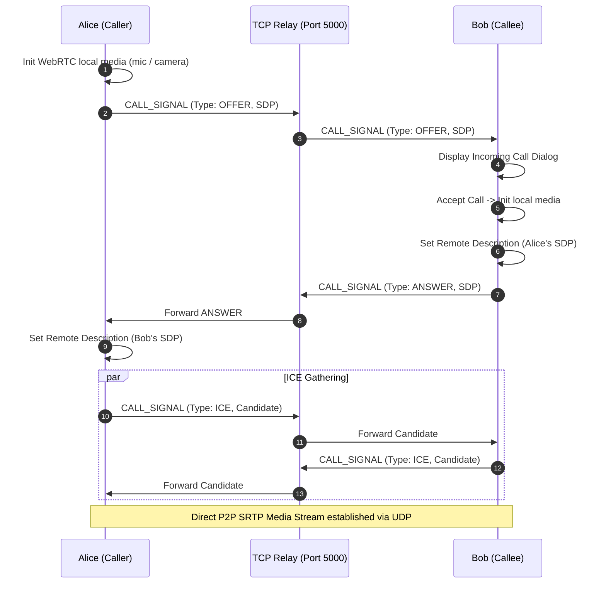

# VeilChat Networking and Wire Protocol

VeilChat uses a decoupled networking model:
1. **Persistent TCP Socket** on Port `5000` for low-latency messaging, signaling, and presence.
2. **HTTP REST Service** on Port `5001` for heavy encrypted file and media distribution.
3. **P2P WebRTC Media Streams** over dynamic UDP for real-time voice and video calls.

---

## 1. TCP Wire Protocol (Port 5000)

All communications over the TCP socket connection follow a strict, fixed-header binary framing protocol.

### 1.1 Packet Framing Specification
Every transmission starts with a fixed **20-byte ASCII header**, followed immediately by the variable-length UTF-8 payload:

```
0                   10                  20
+-------------------+-------------------+------------------------------------------+
|  Packet Type      |  Payload Length   |  JSON Payload (UTF-8 encoded)            |
|  (10 Bytes ASCII) |  (10 Bytes ASCII) |  (N Bytes as specified in Length Header) |
+-------------------+-------------------+------------------------------------------+
```

* **Type Header (Bytes 0–9)**: ASCII string representing the command or message category. Right-padded with spaces to exactly 10 bytes (e.g., `REGISTER  `, `LOGIN     `, `MSG       `).
* **Length Header (Bytes 10–19)**: Decimal integer representing the exact byte length of the following payload. Right-padded with spaces to exactly 10 bytes (e.g., `142       `).
* **Payload (Bytes 20 onwards)**: JSON dictionary serialized into UTF-8.

### 1.2 Packet Types Reference

| Type | Direction | Description | Key JSON Fields |
|---|---|---|---|
| `REGISTER` | Client → Server | Account registration request | `username`, `password`, `device`, `version` |
| `LOGIN` | Client → Server | User authentication request | `username`, `password`, `device`, `version` |
| `AUTH_RES` | Server → Client | Authentication result | `status` (`SUCCESS` or `FAIL`), `msg` |
| `PING` | Client → Server | Heartbeat ping to keep socket alive | `{}` |
| `PONG` | Server → Client | Heartbeat response with server time | `ts` (epoch ms) |
| `MSG` | Client ↔ Server | 1:1 chat message (encrypted ciphertext) | `to_user`, `content`, `sender`, `type`, `messageId` |
| `GRP_MSG` | Client ↔ Server | Group chat message (encrypted) | `groupId`, `sender`, `content`, `messageId` |
| `GET_USERS` | Client → Server | Request list of all contacts and presence | `{}` |
| `USER_LIST` | Server → Client | Roster of users and online statuses | `users`: `{"<user>": {"status": "...", "lastSeen": ...}}` |
| `CALL_SIGNAL` | Client ↔ Server | WebRTC SDP offer, answer, or ICE candidate | `to_user`, `signalType` (`OFFER`/`ANSWER`/`ICE`), `data` |
| `GRP_CREATE` | Client → Server | Group creation request | `groupId`, `name`, `members` |
| `GRP_INV` | Server → Client | Group invitation broadcast | `groupId`, `name`, `owner`, `members`, `inviter` |

---

## 2. HTTP Media Protocol (Port 5001)

Heavy assets (images, encrypted audio files, documents) are handled out-of-band by the Flask HTTP media server to prevent packet interleaving and socket blocking on Port 5000.

### 2.1 Endpoints

#### `POST /upload`
Uploads an encrypted file multipart payload.
* **Request**: `multipart/form-data` with field `file`.
* **Max Size**: 50 MB (`MAX_CONTENT_LENGTH = 50 * 1024 * 1024`).
* **Response (200 OK)**:
  ```json
  {
    "filename": "1780501849743_b992302e.enc",
    "size": 80128
  }
  ```

#### `GET /download/<filename>`
Downloads an encrypted file blob.
* **Path Validation**: Evaluated using `os.path.basename()` to reject path traversal exploits (e.g. `../../etc/passwd`).
* **Response (200 OK)**: Streamed binary bytes with Content-Disposition headers.
* **Response (404 Not Found)**: `{"error": "Not found"}`

#### `GET /health`
Returns service status and total stored file count.
* **Response (200 OK)**:
  ```json
  {
    "status": "ok",
    "files": 42
  }
  ```

---

## 3. WebRTC Call Flow via Signaling Relay


