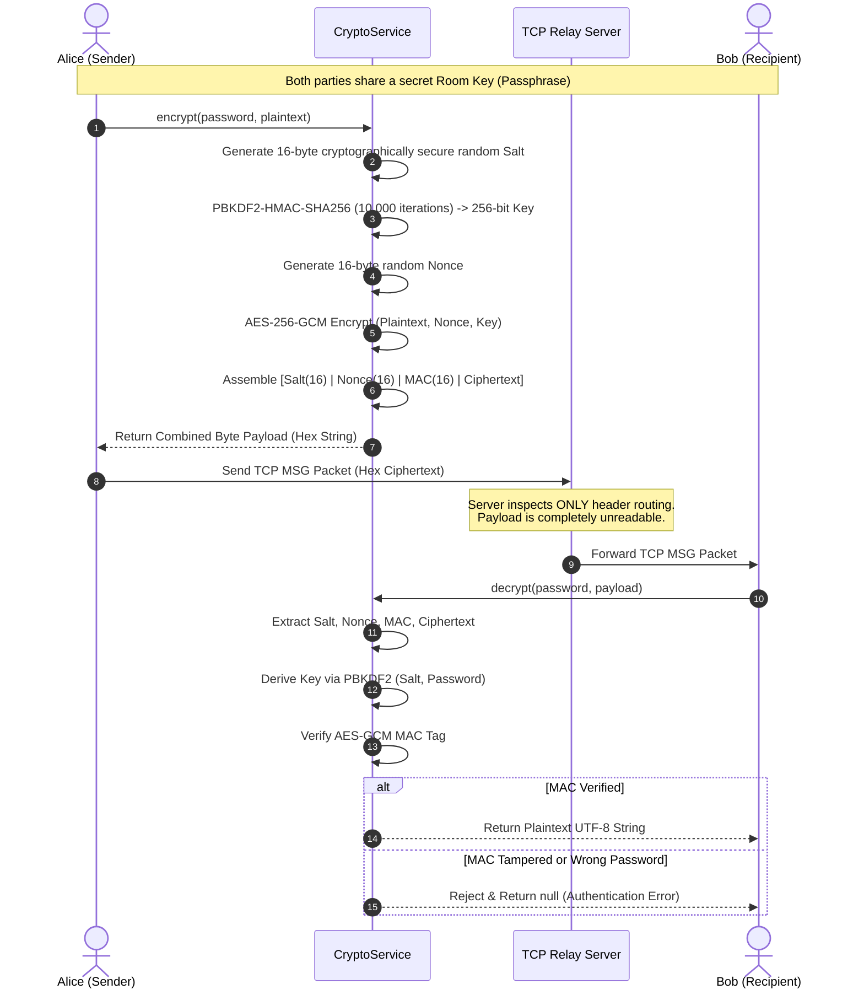
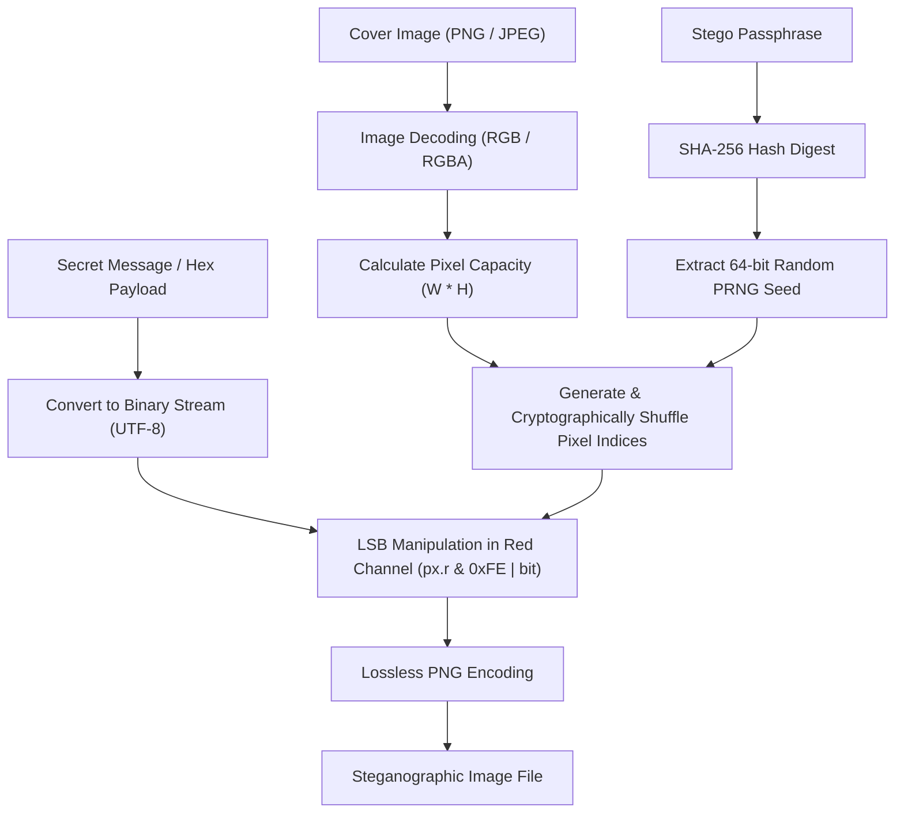

# VeilChat Security Model

## 1. Cryptographic Architecture

VeilChat enforces end-to-end encryption (E2EE) using authenticated symmetric cryptography. The central routing server acts strictly as a blind packet dispatcher with zero access to message contents or keys.



### 1.1 Cryptographic Primitives & Parameters
* **Cipher Suite**: AES-256-GCM (Galois/Counter Mode).
* **Key Size**: 256 bits (32 bytes).
* **Key Derivation Function**: PBKDF2 (Password-Based Key Derivation Function 2) using HMAC-SHA256.
* **Iteration Count**: 10,000 iterations (benchmarked to thwart brute-force password guessing while maintaining smooth ~30ms derivation on resource-constrained mobile hardware).
* **Salt**: 16 bytes, dynamically generated per message using `Random.secure()`.
* **Nonce / IV**: 16 bytes, uniquely generated per encryption operation.
* **Message Authentication Code (MAC / Tag)**: 16 bytes (128 bits), verified during decryption.

### 1.2 Binary Serialization Format
The complete cryptographic payload emitted by `CryptoService` is structured as a continuous binary byte sequence:

```
+----------------+----------------+----------------+--------------------------+
|  Salt (16 B)   |  Nonce (16 B)  |   MAC (16 B)   |   Ciphertext (Variable)  |
+----------------+----------------+----------------+--------------------------+
```
* **Header Overhead**: Fixed 48 bytes.
* **Integrity Guarantee**: Tampering with any byte of ciphertext or header triggers an immediate `SecretBoxAuthenticationError` in the recipient isolate, discarding the corrupted payload.

---

## 2. Steganography Engine (Randomized LSB)

VeilChat provides a custom steganographic engine to conceal sensitive messages within digital carrier images, achieving plausible deniability.



### 2.1 Shuffling Algorithm
To defeat linear steganalysis tools that detect sequential LSB alteration:
1. The user supplies a stego password.
2. The SHA-256 digest of the password is calculated.
3. The first 8 bytes of the digest form a 64-bit integer seed:
   $$\text{Seed} = \sum_{i=0}^7 (\text{digest}[i] \ll (56 - 8i))$$
4. A deterministic pseudo-random number generator (`Random(seed)`) shuffles an array of all pixel indices $[0, W \times H - 1]$.
5. Secret data bits are scattered non-linearly across the image according to this shuffled index sequence.

### 2.2 Payload Framing & Capacity
* **Length Prefix**: The first 32 scattered bits store the payload byte length as a 32-bit big-endian integer.
* **Red Channel LSB**: Data is embedded strictly into the least significant bit of the Red color channel (`(px.r & 0xFE) | bit`), preserving Green and Blue channels intact.
* **Format Preservation**: Output files are strictly serialized as lossless **PNG** (`img.encodePng`) because lossy compression (such as JPEG quantization) destroys LSB bit patterns.

---

## 3. Server Privacy & Data Sovereignty

* **Zero Plaintext Storage**: The relay server logs only connection timestamps and usernames; message bodies are never decrypted on the server.
* **Ephemeral Offline Queuing**: Offline messages are buffered in memory and persisted in `server_offline.json` only until the recipient reconnects. Once delivered, they are purged immediately via `all_.pop(username)`.
* **Queue Caps**: Per-user offline message queues are capped at 200 items to prevent denial-of-service and storage exhaustion.
* **Encrypted Media Storage**: Files uploaded to `server/media_uploads/` are pre-encrypted client-side with AES-256-GCM before transport. The media server stores opaque ciphertext blobs with no ability to inspect them.

---

## 4. Local Database Security

* **Database Engine**: SQLite via `sqflite` (`veilchat_v9.db`).
* **Storage Sovereignty**: Message history, contact nicknames, and call logs are stored exclusively on the user's physical device.
* **Media Decoupling**: Large media files (images, audio notes) are stored as files in the application's protected sandbox directory; only absolute paths and encrypted metadata are recorded in the database tables.
